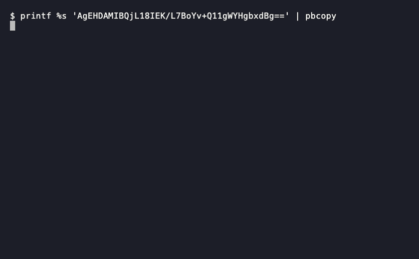

<h1>&nbsp;sketchprobe</h1>

[](https://github.com/yadavan88/sketchprobe/actions/workflows/ci.yml)
[](https://github.com/yadavan88/sketchprobe/actions/workflows/native.yml)
[](https://github.com/yadavan88/sketchprobe/actions/workflows/web.yml)
[](LICENSE)

**Inspect and decode [Apache DataSketches](https://datasketches.apache.org/) binaries.** Find a serialized sketch in MongoDB, Parquet, Delta or Databricks, and get a readable report.

**[Try it in your browser](https://yadavan88.github.io/sketchprobe/)**: paste a value, nothing is uploaded. Or install the command line tool, below.



Copy the sketch value from your tool (the base64 or hex text, or the Mongo `$binary` field), then run:

```bash
pbpaste | sketchprobe      # macOS
xclip -o | sketchprobe     # Linux
```

To make it one word, add a `skp` shortcut, see [A shortcut](#a-shortcut).

Spark and Databricks users: run `SELECT base64(hll_sketch_agg(col)) FROM t`, copy the cell, and pipe it in for a readable report (`theta_sketch_agg` works the same way).

You can also pass the value as an argument or a file, see [Usage](#usage). The report for a Frequency sketch looks like this:

```
Frequency sketch (string items)                                 confidence: high

Input             base64, 620 bytes
Stream length     16,924,897
Items tracked     29 (the table holds up to 48)
Maximum error     0 (every count is exact)
Item type         string (chosen from the blob's size)

Items, largest first (top 20 of 29)
  Item               Count
  iPhone        12,866,315
  MacIntel       3,361,170
  ...
```

## Try it in the browser

**https://yadavan88.github.io/sketchprobe/** runs the same decoder in your browser, compiled to WebAssembly. Paste the sketch value and press Decode. The value never leaves the page: there is no server, and the page makes no request with it.

It reads every family the command line does, with one exception: the **compressed Theta** layout is refused with a message, so use the command line for it. (The Apache DataSketches library reads it wrongly when compiled to WebAssembly: GraalVM's experimental WebAssembly compiler returns a byte read from a heap `MemorySegment` as a signed value. The tool refuses it instead of showing a wrong answer.) There is no `--file` either, since a page has no files.

It needs a current Chrome, Edge or Firefox (WebAssembly with exception handling; Safari is not tested yet). To build it yourself, see [docs/building.md](docs/building.md#browser-version).

## Features

- **Families:** HLL, Theta (Alpha, QuickSelect, Compact including the compressed layout, Union, Intersection), KLL (float, double or long items, compact and working layouts), Quantiles (the classic doubles sketch) and Frequency (long or string items). Any other family is recognized and named, not decoded.
- **Any text form of the value:** base64 (standard or URL-safe), hex (`0x…`, `\x…`), Mongo Extended JSON (current and legacy, also nested in a document), a quoted string, or raw bytes. The format is detected and shown.
- **Safe on hostile input:** sketches are read with the Apache DataSketches Java library (9.0.0), but only after the tool's own checks, because the library trusts the sizes in a header and a forged blob can make it run out of memory. Truncated, bit-flipped, forged and random input all end in a clear message and a distinct exit status, never a crash.
- **Read-only and offline:** it never writes a file or opens a connection. A build check fails the compile if production code uses such an API.
- **Self-contained:** the released executable needs no Java.

## Supported sketches

| Sketch | Family IDs | What you get | `--type` needed |
|---|---|---|---|
| **Theta** | Alpha, QuickSelect, Compact (also the compressed layout), Union, Intersection | estimate, bounds, theta, retained hashes | no |
| **HLL** | HLL | estimate, bounds, lgK | no |
| **KLL** | KLL (compact and working layouts) | n, min, max, quantiles, retained items | yes: `float`, `double` or `long` |
| **Quantiles** | Quantiles (compact and working layouts) | n, min, max, quantiles, retained items | no, the items are always doubles |
| **Frequency** | Frequency | stream length, maximum error, items with counts | no, worked out from the size (`long` or `string`) |

Every other DataSketches family (Tuple, CPC, REQ, Reservoir, VarOpt, CountMin, TDigest, Bloom, Xor and more) is recognized and named, but not decoded. So are AnotB (the library never serializes it), legacy Theta and Quantiles layouts (serVer 1 and 2) and KLL sketches of strings.

## Install

Pick one. The first three need no Java; the jar does.

| Way | Command | Platforms |
|---|---|---|
| **Install script** (recommended) | `curl -fsSL https://raw.githubusercontent.com/yadavan88/sketchprobe/main/packaging/install.sh \| sh` | macOS (Apple silicon, Intel), Linux x86-64 |
| **Homebrew** | see below | macOS (Apple silicon, Intel), Linux x86-64 |
| **Manual download** | take the archive for your platform from the [latest release](https://github.com/yadavan88/sketchprobe/releases/latest), unpack it, put `sketchprobe` on your `PATH` | same |
| **Jar** | `java -jar sketchprobe.jar` from the release; needs JDK 25 | anywhere Java runs |

```bash
# Homebrew
brew tap yadavan88/sketchprobe https://github.com/yadavan88/homebrew-sketchprobe
brew trust yadavan88/sketchprobe      # recent Homebrew asks you to trust a third-party tap
brew install sketchprobe
```

The install script downloads the release, checks it against `SHA256SUMS`, and installs one file into `~/.local/bin`. Options:

| Option | Effect |
|---|---|
| `--dir DIR` | install somewhere else |
| `--version X.Y.Z` | install that release instead of the latest |
| `--jlink` | install the bundled-runtime build instead (see below) |

To pass an option through the pipe, use `sh -s --`, for example `... | sh -s -- --dir ~/bin`.

### Which build do I get?

| Build | Size | Start-up | Release file |
|---|---|---|---|
| **Native executable** (the default) | about 7 MB | about 8 ms | `sketchprobe-<platform>.tar.gz` |
| **Bundled runtime** (`--jlink`) | about 50 MB | about 100 ms | `sketchprobe-<platform>-jlink.tar.gz` |
| **Jar** | 12 MB | about 170 ms, needs JDK 25 | `sketchprobe.jar` |

`<platform>` is `macos-arm64`, `macos-x86_64` or `linux-x86_64`. The native executable is the one to use. The bundled runtime is a fallback with the same behaviour, for a machine where the native executable does not run. It keeps a whole folder (`~/.local/share/sketchprobe`) instead of one file. Windows is not supported.

## Usage

First **copy the sketch value** from wherever you found it. Then, from the most to the least convenient:

```bash
pbpaste | sketchprobe               # 1. read the clipboard (macOS; Linux: xclip -o | sketchprobe)
sketchprobe                         # 2. or run it alone and paste when asked (small sketches only, see below)
sketchprobe 'CgEHDAAICAKn...'       # 3. or give the value as text (quote it; Mongo JSON needs quotes)
sketchprobe --file value.b64        # 4. or give a file: raw sketch bytes, or text in any format
```

### A shortcut

To read the clipboard with one word, add a function to `~/.zshrc` or `~/.bashrc`:

```bash
skp() { pbpaste | sketchprobe "$@"; }          # macOS
# skp() { xclip -o | sketchprobe "$@"; }       # Linux
```

Then copy a value and run `skp`. Options pass through: `skp --type double`, `skp --json`. A function is used rather than an alias so the options reach `sketchprobe`.

Pasting at the prompt (2) needs no quoting and leaves nothing in your shell history, but a terminal cuts a pasted line at about 1,000 characters (macOS; about 4,000 on Linux) and drops the rest silently. Most real sketches are longer than that once written as text, so for those use the clipboard (1) or a file (4). If a paste is cut, the tool tells you, or after a few seconds of silence reminds you to press Ctrl-C. A value that starts with `-` goes after `--` (`sketchprobe -- -abc...`).

Where the value comes from:

```bash
# MongoDB: a binary field as mongosh or Compass prints it. Braces, quotes and a trailing comma are fine.
echo '{ "$binary" : "AQEKAwMFAAA=", "$type" : "00" },' | sketchprobe

# Databricks / Spark SQL: select the column as text, then copy the cell
#   SELECT base64(sketch_col) FROM t LIMIT 1        -- or hex(sketch_col)

# Parquet / Delta: write the value out as base64 and give the file
python3 -c "import pyarrow.parquet as pq,base64; t=pq.read_table('f.parquet'); print(base64.b64encode(t['sketch'][0].as_py()).decode())" > value.b64
sketchprobe --file value.b64

# A KLL sketch does not record its item type, so say it. (Frequency works it out from the size.)
pbpaste | sketchprobe --type double
```

The input forms are tested against corpus blobs and encoded variants of them. The Spark SQL `hll_sketch_agg` and `theta_sketch_agg` outputs were checked with open-source Spark 4.2.1 (not on Databricks itself). The Parquet line shows where such a value comes from, and is not tested against that system.

### Options

| Option | Effect |
|---|---|
| `--json` | one line of JSON instead of text ([schema](docs/report.schema.json)); failures print a JSON object too |
| `--file FILE` | read the sketch from a file (`-` is standard input) |
| `--type float\|double\|long\|string` | the item type: KLL takes float, double or long; Frequency takes long or string |
| `--show-hashes`, `--show-items` | list retained Theta hashes, KLL items, or all Frequency items (the report shows the top 20 by default) |
| `--ranks 0.5,0.99` | the quantiles to report for KLL |
| `--seed N` | the Theta seed, to check the stored seed hash (a mismatch is a warning; the values do not depend on it) |
| `--header-only` | identify the sketch and stop |
| `--input-format F` | `auto` (default), `mongo`, `hex`, `base64`, `base64url`, `raw` |

`sketchprobe --help` lists everything.

### Exit status

| Status | Meaning |
|---|---|
| 0 | decoded (possibly with a warning: medium confidence, a Theta seed mismatch, an ignored option) |
| 1 | unreadable input: empty, not a known text format, several blobs, ambiguous format, over the size limit, unreadable file |
| 2 | not a recognizable sketch: fewer than 8 bytes, an unknown family ID, an invalid field (the raw header is shown) |
| 3 | recognized but not decoded: unsupported family, truncated or forged-size blob, big-endian layout, missing item type |
| 64 | usage error |

A failure prints a plain reason and, where there is one, a next step on standard error. With `--json` the same is also an object on standard output.

## Building

You need **JDK 25**. The DataSketches library is compiled for Java 25. If you use [Coursier](https://get-coursier.io/), it can fetch one for you (more commands in the [Coursier cheatsheets](https://github.com/yadavan88/coursier-cheatsheets)):

```bash
eval "$(cs java --jvm temurin:25 --env)"    # JDK 25 for this shell only
cs java --jvm temurin:25 --setup            # or make it your default
```

Otherwise point `JAVA_HOME` at any JDK 25:

```bash
export JAVA_HOME=/path/to/jdk-25
sbt test                    # the tests
sbt cli/assembly            # the fat jar: cli/target/scala-3.9.0/sketchprobe.jar
```

The native executable and `jlink` builds, with sizes, start-up times and notes, are in [docs/building.md](docs/building.md).

## License

Apache-2.0, see [LICENSE](LICENSE) and [NOTICE](NOTICE). Apache DataSketches is a trademark of the Apache Software Foundation. This project is not affiliated with or endorsed by it.
